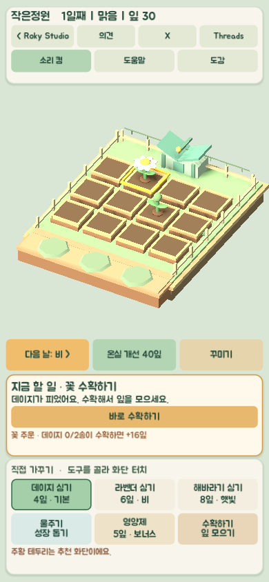
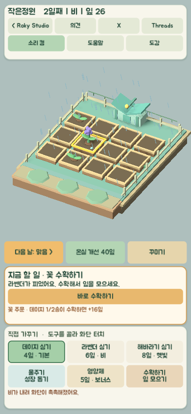
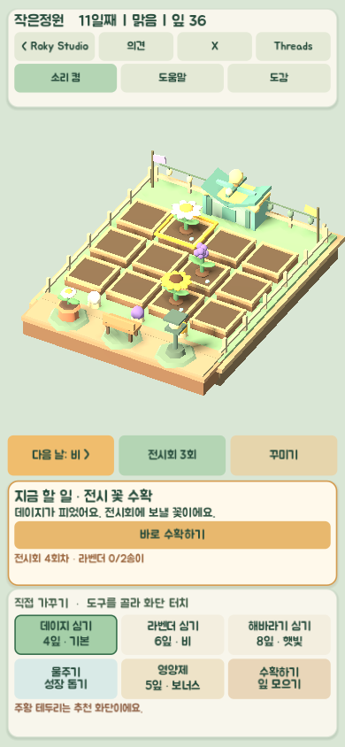
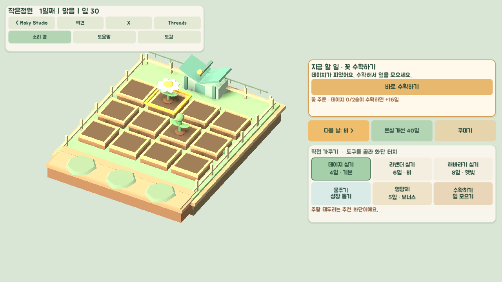
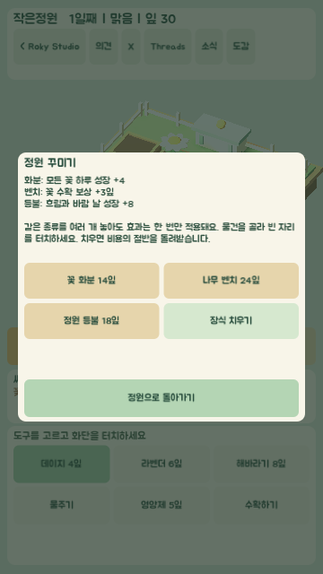

# 작은정원

Godot 4로 만든 세로 화면 3D 정원 가꾸기 시제품입니다. 첫 공개는 웹을 가정해 Compatibility 렌더러와 GDScript를 사용합니다.











## 실행

1. [Godot 4.7.2](https://godotengine.org/download/archive/4.7.2-stable/) 또는 호환되는 Godot 4 편집기로 이 폴더의 `project.godot`을 엽니다.
2. 편집기에서 **프로젝트 실행(F6가 아닌 F5)**을 누릅니다.
3. 처음에는 **지금 할 일**의 큰 버튼을 따라 누릅니다. 수확, 심기, 물주기, 다음 날 보내기를 현재 정원 상태에 맞춰 제안합니다. 직접 고르고 싶으면 아래 도구를 선택하고 화단을 누릅니다. 주황 테두리는 추천 화단입니다. 잎이 모자라고 정원에 꽃이 없을 때는 데이지 한 송이를 무료로 심을 수 있습니다. 화면의 **꽃 주문**에 맞는 꽃을 수확하면 보너스 잎을 받습니다. **꾸미기**에서 물건을 골라 정원 앞 장식 자리를 누르면 잎을 사용해 배치합니다. **도감**에서 꽃별 수확 기록과 목표를 확인할 수 있습니다.

장식은 꽃 화분 14잎, 나무 벤치 24잎, 정원 등불 18잎입니다. 장식 자리는 3개이며, 이미 찬 자리는 **꾸미기 → 장식 치우기**로 비워야 합니다. 치울 때 구매 비용의 절반을 돌려받습니다.

- 꽃 화분: 모든 꽃의 하루 성장 +4
- 나무 벤치: 꽃 수확 보상 +3잎
- 정원 등불: 흐리거나 바람 부는 날의 하루 성장 +8

장식 효과는 종류별로 한 번만 적용됩니다. 같은 장식을 여러 개 놓아도 효과가 중복되지는 않습니다. 현재 적용 중인 효과는 **도감**에서 확인할 수 있습니다.

온실 3단계를 완성하면 **정원 전시회**가 열립니다. 전시회 버튼에서 데이지·라벤더·해바라기 목표를 확인하고, 필요한 꽃을 수확해 한 회차를 완료할 수 있습니다. 주제는 봄빛·비향기·햇살·색채 순으로 바뀌며 반복됩니다. 완료할 때마다 잎 보상을 받고 울타리의 등불이 하나씩 켜집니다. 1·3·6회에는 깃발과 아치 장식도 추가됩니다. 전시회 횟수와 진행도는 자동 저장과 JSON 백업에 포함됩니다.

꽃마다 성장 특성이 다릅니다. 데이지는 매일 성장 +6, 라벤더는 비 오는 날 +12, 해바라기는 맑은 날 +12입니다. **다음 날** 버튼의 날씨 예보를 보고 심을 꽃을 고를 수 있습니다. 이 보너스는 물주기·영양제·장식 효과와 함께 적용됩니다.

잔잔한 배경음과 심기·물주기·영양제·수확·하루 보내기·온실 개선·장식 효과음을 제공합니다. 웹 브라우저에서는 첫 버튼 클릭이나 정원 터치 뒤에 소리가 시작됩니다. 상단 **소리 켬/소리 끔** 버튼으로 배경음과 효과음을 함께 전환할 수 있고, 선택은 이 기기의 저장 데이터에 남습니다. 원본 WAV는 `assets/audio/`에 있으며 `node scripts/generate-audio.mjs`로 다시 만들 수 있습니다.

날씨에 따라 정원의 빛과 배경색도 바뀝니다. 비 오는 날에는 움직이는 빗줄기와 젖은 바닥 색감, 바람 부는 날에는 날리는 잎이 보입니다. 효과는 가벼운 3D 오브젝트를 사용하며 날짜를 넘기거나 백업을 불러올 때 함께 전환됩니다.

진행 상황은 각 기기의 `user://garden_save.json`에 자동 저장됩니다. 웹에서는 해당 브라우저의 IndexedDB에 저장되므로 브라우저 데이터를 지우거나 비공개 모드를 사용하면 기록이 사라질 수 있습니다. 화면 위 **도움말 → 저장 백업 / 백업 불러오기**로 JSON 파일을 내려받거나 가져올 수 있습니다. 같은 기기의 기존 진행 상황을 백업으로 덮어쓰므로 불러오기 전에 현재 기록을 백업하세요. 기기 간 자동 동기화는 없습니다.

기존 시험용 웹 주소에서 만든 저장 데이터는 GitHub Pages 주소로 자동 이전되지 않습니다. 시험용 주소에서 JSON 백업을 내려받은 뒤 새 주소에서 **백업 불러오기**를 사용하세요.

## 웹에서 실행

공개 웹판: **[작은정원 바로가기](https://mcroky.github.io/small-garden/)**. PC와 휴대폰 브라우저에서 같은 주소로 접속합니다. 첫 실행에는 게임 파일을 내려받느라 잠시 걸릴 수 있습니다. 진행 상황은 브라우저별로 로컬 저장되며 기기 간 자동 동기화는 되지 않습니다.

웹 빌드는 `build/web`에 있습니다. 로컬 개발 시 브라우저 보안 정책상 파일을 직접 열지 말고 로컬 서버로 실행합니다.

```powershell
node scripts/serve.mjs build/web 8765
```

브라우저에서 `http://127.0.0.1:8765`를 엽니다. 웹 화면은 창 폭에 따라 세로 배치와 가로 2열 배치로 바뀝니다. Godot에서 다시 내보낼 때는 **프로젝트 → 내보내기 → Web**을 선택합니다. `export_presets.cfg`는 단일 스레드 웹 빌드로 설정되어 있습니다.

### GitHub Pages 배포

GitHub Pages는 `main` 브랜치의 `docs/`를 배포합니다. Godot에서 Web 내보내기를 갱신한 뒤 다음 명령으로 배포 파일을 준비하고 푸시합니다.

```powershell
node scripts/prepare-pages.mjs
git add docs
git commit -m "Update web build"
git push origin main
```

휴대폰에서는 위 공개 HTTPS 주소를 열어 심기·물주기·다음 날·수확하기를 터치해 보고, 브라우저 재실행 후 저장 지속성을 확인합니다.

## 현재 범위

- 12개 화단, 성장 특성이 다른 꽃 3종, 물주기, 영양제, 수확, 3단계 온실 개선, 날씨 예보와 성장·정원 외형 변화
- 꽃별 수확 도감: 각 꽃 3송이 수확 시 장식과 잎 12개 보너스
- 순서대로 반복되는 꽃 주문: 지정 꽃 2송이를 수확하면 보너스 잎을 받고 다음 주문으로 이동
- 온실 3단계 뒤에 열리는 반복 정원 전시회: 네 가지 꽃 수확 목표, 회차별 보상과 누적 장식
- 정원 앞 장식 자리 3개: 꽃 화분·나무 벤치·정원 등불 구매, 배치, 치우기와 종류별 돌봄 효과
- 16초 반복 배경음, 행동별 효과음 8종, 저장되는 소리 켜기·끄기 설정
- 터치/마우스 조작, 현재 상태에 맞는 큰 행동 버튼과 추천 화단, 세로·가로 화면 UI, 기기별 자동 저장과 JSON 백업/복원
- Roky Studio 복귀, 의견 보내기, X·Threads 링크, 도움말과 저장 안내

390×844, 360×640 세로 창과 1024×768, 1280×720 가로 창에서 레이아웃을 확인했습니다. 웹 빌드는 로컬과 공개 주소의 PC 브라우저에서 확인했습니다. 휴대폰 브라우저 성능, 터치 조작, 소리 재생, 저장 지속성은 실기기에서 확인해야 합니다. 한글 UI에는 [Google Fonts Jua](https://fonts.google.com/specimen/Jua)를 사용하며 라이선스는 `assets/fonts/Jua-OFL.txt`에 있습니다. 향후 계획은 [PROJECT_PLAN.md](PROJECT_PLAN.md)를 참고하세요.

기존 v1·v2·v3·v4 저장 파일과 백업은 자동으로 읽습니다. 이전 버전의 화단·잎·온실·도감·꽃 주문·장식 상태는 유지되고, 새 전시회 진행도만 0부터 시작합니다.
